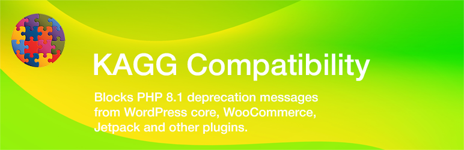

# KAGG Compatibility

The plugin blocks error messages of any level from WordPress core, plugins, and themes.

WordPress core, plugins, and themes can emit notices and deprecation messages on newer PHP versions. See the [WordPress PHP compatibility guide](https://make.wordpress.org/core/handbook/references/php-compatibility-and-wordpress-versions/) for the current core support status.

The same is related to many popular plugins such as WooCommerce, Jetpack, Gravity Forms and others. Mainly, they produce deprecation notices from the Action Scheduler library.



## Features

* The plugin blocks deprecation notices, user deprecation notices, notices, warnings, user notices, and user warnings.
* The list of folders from which errors are blocked can be filtered. This list may specify any WordPress Core, plugin and theme folders.
* Plugin filters out errors from these folders only. Errors produced by other code are not blocked, which helps in debugging user code.
* During activation, plugin installs a mu-plugin `kagg-compatibility-error-handler.php` into the `/wp-content/mu-plugins/` folder. It contains the error handler, which loads earlier than any plugin or theme.

## Installation

```
git clone https://github.com/kagg-design/kagg-compatibility.git
cd kagg-compatibility
composer install --no-dev
```

## Development

```
git clone https://github.com/kagg-design/kagg-compatibility.git
cd kagg-compatibility
composer install
```

## License

The WordPress Plugin KAGG Compatibility is licensed under the GPL v2 or later.

> This program is free software; you can redistribute it and/or modify it under the terms of the GNU General Public License, version 2, as published by the Free Software Foundation.

> This program is distributed in the hope that it will be useful, but WITHOUT ANY WARRANTY; without even the implied warranty of MERCHANTABILITY or FITNESS FOR A PARTICULAR PURPOSE. See the GNU General Public License for more details.

> You should have received a copy of the GNU General Public License along with this program; if not, write to the Free Software Foundation, Inc., 51 Franklin St, Fifth Floor, Boston, MA 02110-1301 USA

A copy of the license is included in the root of the plugin’s directory. The file is named `LICENSE`.

## Credits

The current version of the KAGG Compatibility was developed by KAGG Design.

## Release checks

The supported runtime remains PHP 7.4+ and WordPress 6.0+. Composer resolves
development tools against PHP 7.4.33; commit the lockfile when updating them.
Vulnerability checks use `composer audit` in CI; the current Roave advisory package blocks the supported PHP 7.4 runtime. There is no JavaScript package manager or asset build in this repository.

```sh
composer validate --strict
composer audit
composer phpcs
composer test
composer changelog
composer changelog:check
node --check assets/js/general.js
node --check assets/js/general.min.js
```

`composer test` runs the PHPUnit suite configured in `phpunit.xml`. To run
one test, use `composer test -- --filter test_keeps_the_guard_active_for_all_recursive_entries`.
The suite uses `WP_Mock` for WordPress functions and hooks, matching the unit-test
setup in Cyr-To-Lat. No WordPress installation or database is needed.
PHPUnit 9.6 keeps the tests compatible with PHP 7.4 and newer.

In PhpStorm, select the shared **unit all** PHPUnit configuration and click Run.
It uses the project's PHP interpreter, `vendor/autoload.php`, and `phpunit.xml`.
Individual test classes and methods can also be run with the gutter Run button.

`composer changelog` merges every readme release into `changelog.txt`, preserving
archived versions. Keep all 2.x releases in `readme.txt` while preparing a 2.x release.
Run `composer prepare` once to enable the staged-changelog pre-commit check.
If PHP is not on PATH in Git hooks, set `git config kagg-compatibility.phpPath /path/to/php`.

To check loading, settings hooks, activation/deactivation payload handling, and
error suppression against an installed WordPress, run:

```sh
wp --path=/path/to/wordpress --skip-plugins --skip-themes eval-file /path/to/kagg-compatibility/tests/wordpress.php
```

This smoke check uses in-memory plugin options and a temporary mu-plugin payload.
It does not cover browser UI or third-party plugins running together.
CI checks all supported stable PHP versions on every PR; pushes use PHP 7.4 and 8.5.
Publishing remains a separate action through the existing GitHub release workflow.
